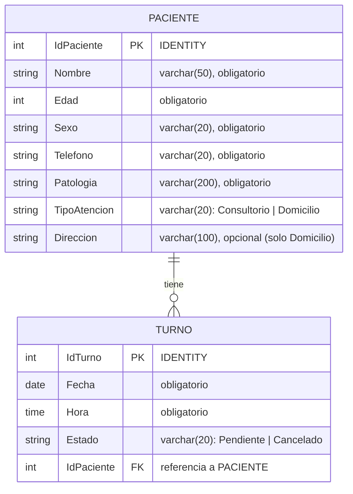

# DER · Diagrama Entidad-Relación

La base de datos tiene dos tablas. Un paciente puede tener muchos turnos y cada turno pertenece a un único paciente (relación 1:N).

## Reglas del modelo

- `Turno.IdPaciente` es clave foránea hacia `Paciente.IdPaciente`.
- El borrado de un paciente con turnos está restringido (`ON DELETE NO ACTION`).
- `Estado` tiene por defecto `Pendiente`; la cancelación es lógica (`Cancelado`).
- `TipoAtencion` y `Direccion` se guardan en `Paciente` según el diseño solicitado.
- Índices: `IX_Paciente_Telefono`, `IX_Turno_Fecha_Hora` e `IX_Turno_IdPaciente`.

## Script SQL

El script manual está en [`database/ProyectoKine.sql`](../database/ProyectoKine.sql). La migración de Entity Framework Core genera exactamente el mismo esquema y se encuentra en `ProyectoKine.BD/Migrations`.
