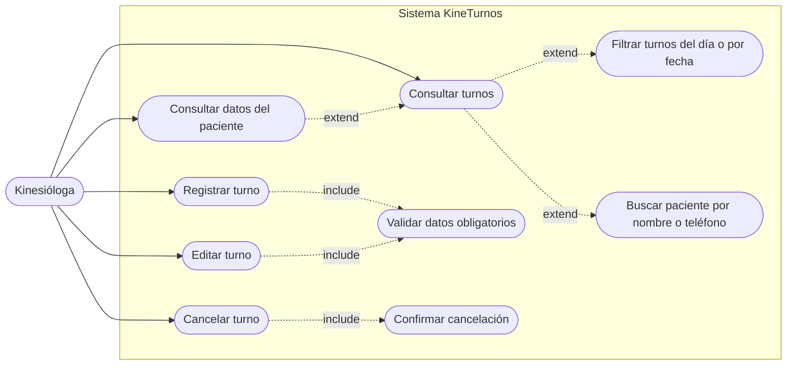

# Diagrama de Casos de Uso

Actor principal: **Kinesióloga** (única usuaria, sin login ni roles).

## Descripción de los casos de uso

| Caso de uso | Descripción | Requisito |
|---|---|---|
| Registrar turno | Carga los datos del paciente y del turno (fecha, hora, modalidad y dirección si es a domicilio). | RF01, RF06, RF07 |
| Editar turno | Modifica los datos del paciente y/o el horario y la modalidad. | RF02 |
| Cancelar turno | Cambia el estado del turno a `Cancelado` previa confirmación. | RF03 |
| Consultar turnos | Muestra todos los turnos, los del día o los de una fecha determinada. | RF04 |
| Consultar datos del paciente | Muestra la ficha completa y el historial de turnos. | RF05 |
| Validar datos obligatorios | Valida campos requeridos en el frontend y en la API. | RF06, RF07 |

## Flujo general

1. La kinesióloga abre el inicio y elige **Agregar turno** o **Ver turnos**.
2. En el alta completa los datos y el sistema valida antes de guardar.
3. En la agenda puede filtrar, buscar, editar o cancelar.
4. Desde cada fila puede abrir la ficha del paciente con su historial.
