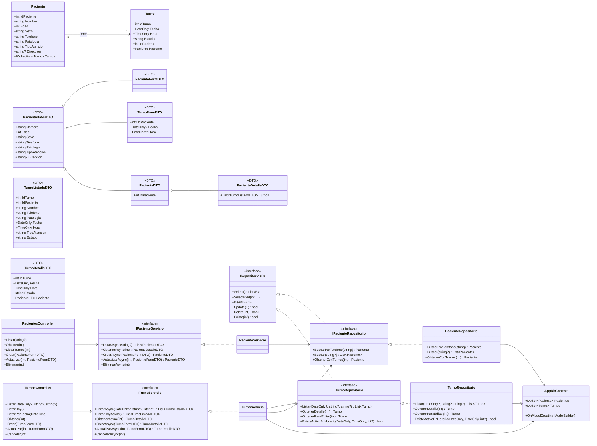

# Diagrama de Clases

Vista simplificada de las clases principales del backend y de la relación entre capas.

> En el diagrama, `PacienteServicio` depende de `IPacienteRepositorio`; `TurnoServicio` usa `ITurnoRepositorio`, `IPacienteRepositorio` y `AppDbContext` (solo para coordinar la transacción de alta).
