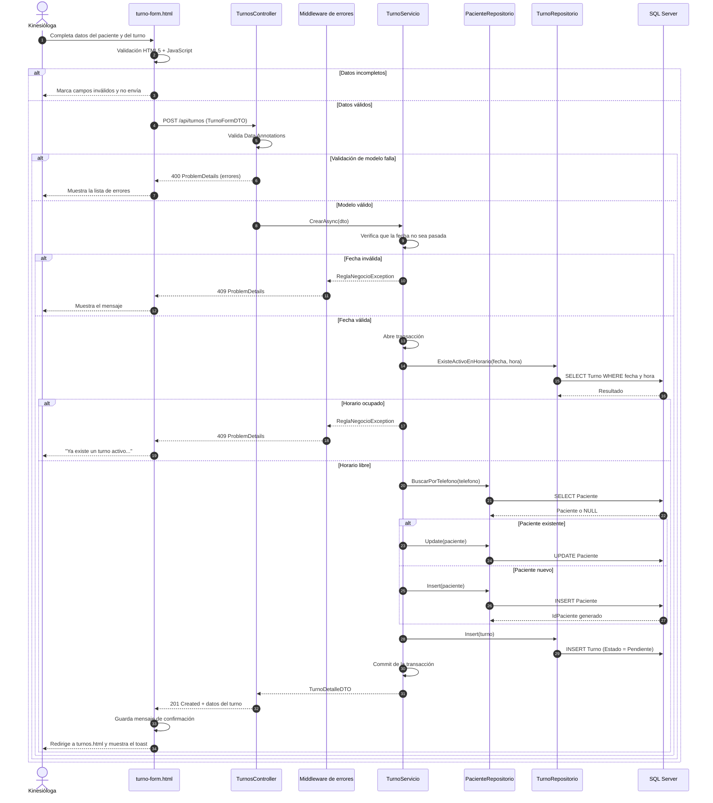

# Diagrama de Secuencia · Agregar Turno

Flujo completo desde el formulario HTML hasta SQL Server, incluyendo las validaciones y los errores posibles.

## Puntos clave

- El formulario y la API validan los datos (doble validación).
- El paciente y el turno se guardan en una **transacción**: si falla el turno, no queda un paciente huérfano.
- El paciente se reutiliza por teléfono cuando ya existe.
- Un turno cancelado no bloquea el horario; uno pendiente sí.
- Los errores de negocio se convierten en HTTP 409 y los recursos inexistentes en HTTP 404 mediante el middleware.
