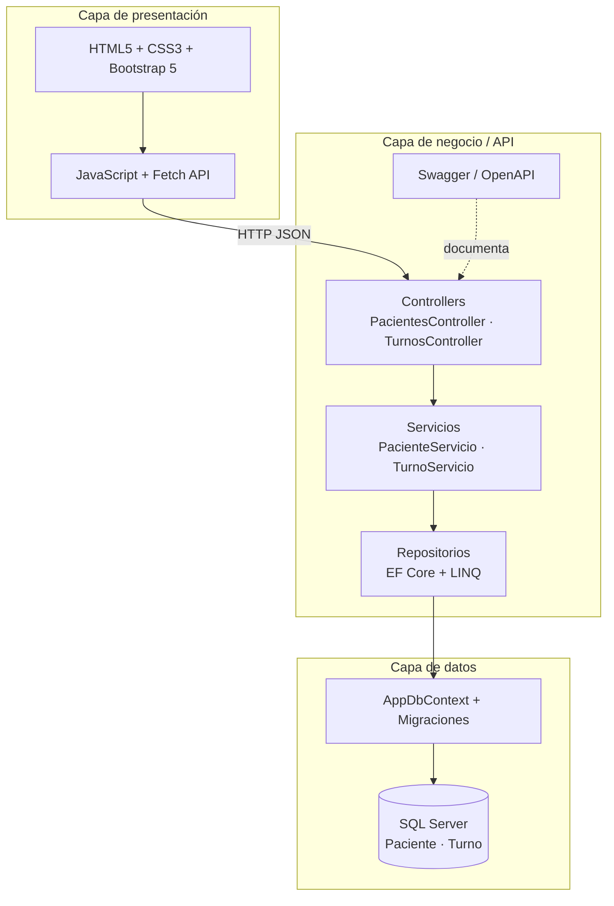

# Arquitectura del sistema

El sistema implementa una arquitectura de tres capas, con separación interna en proyectos para mantener el código ordenado y facilitar el mantenimiento.



## Proyectos de la solución

| Proyecto | Responsabilidad | Depende de |
|---|---|---|
| `ProyectoKine.Shared` | DTOs, constantes de estado y modalidad, validaciones compartidas. | — |
| `ProyectoKine.BD` | Entidades, `AppDbContext`, configuraciones de tablas y migraciones. | Shared |
| `ProyectoKine.Repositorio` | Acceso a datos con EF Core y LINQ (`IRepositorio<T>` y repositorios específicos). | BD, Shared |
| `ProyectoKine.Servicio` | Reglas de negocio, validaciones, mapeo entidad ↔ DTO y transacciones. | BD, Repositorio, Shared |
| `ProyectoKinesiologia` | Web API, controladores, Swagger, middleware de errores y frontend estático. | Todos |

El frontend se sirve desde `wwwroot` del mismo proyecto API, por lo que **no se necesita CORS** ni un servidor adicional.

## Flujo de una petición

1. El navegador ejecuta `fetch` contra `/api/...`.
2. ASP.NET Core enruta al controller correspondiente.
3. `[ApiController]` valida automáticamente los DTO con Data Annotations y devuelve `400` si hay errores.
4. El controller delega en el servicio de negocio.
5. El servicio aplica reglas, usa los repositorios y mapea a DTO.
6. El repositorio ejecuta LINQ sobre EF Core y guarda en SQL Server.
7. Si se lanza `KeyNotFoundException` o `ReglaNegocioException`, el middleware global responde `404` o `409` con `ProblemDetails`.

## Inyección de dependencias

Registradas en `Program.cs` con ciclo de vida **Scoped** (una instancia por request):

```csharp
builder.Services.AddDbContext<AppDbContext>(options => options.UseSqlServer(connectionString));

builder.Services.AddScoped<IPacienteRepositorio, PacienteRepositorio>();
builder.Services.AddScoped<ITurnoRepositorio, TurnoRepositorio>();
builder.Services.AddScoped<IPacienteServicio, PacienteServicio>();
builder.Services.AddScoped<ITurnoServicio, TurnoServicio>();
```

## Decisiones de diseño

- **Cancelación lógica:** el turno no se borra; cambia a `Estado = "Cancelado"` para conservar el historial.
- **Paciente reutilizado por teléfono:** evita duplicados cuando la kinesióloga agenda un nuevo turno a un paciente existente.
- **Alta transaccional:** paciente + turno se guardan juntos.
- **Dirección condicional:** solo es obligatoria con modalidad `Domicilio`; se guarda en el paciente conforme al modelo solicitado.
- **Sin autenticación:** el sistema es de uso exclusivo de la kinesióloga y no requiere login ni roles.
- **Swagger siempre disponible** en `/swagger` para probar la API.
- **Migraciones automáticas en Development:** al iniciar la API se aplican las migraciones pendientes.
